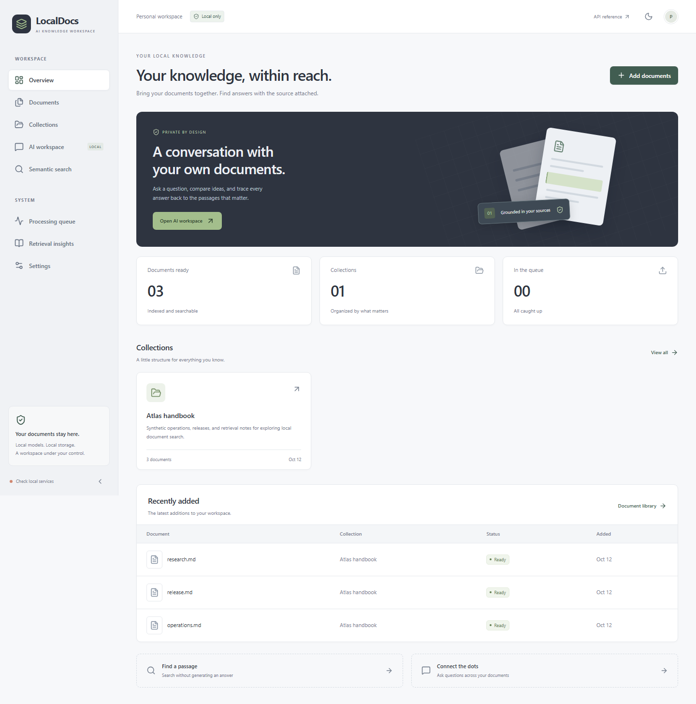
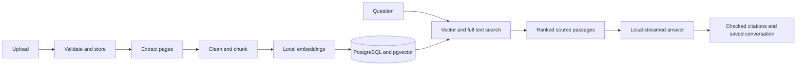
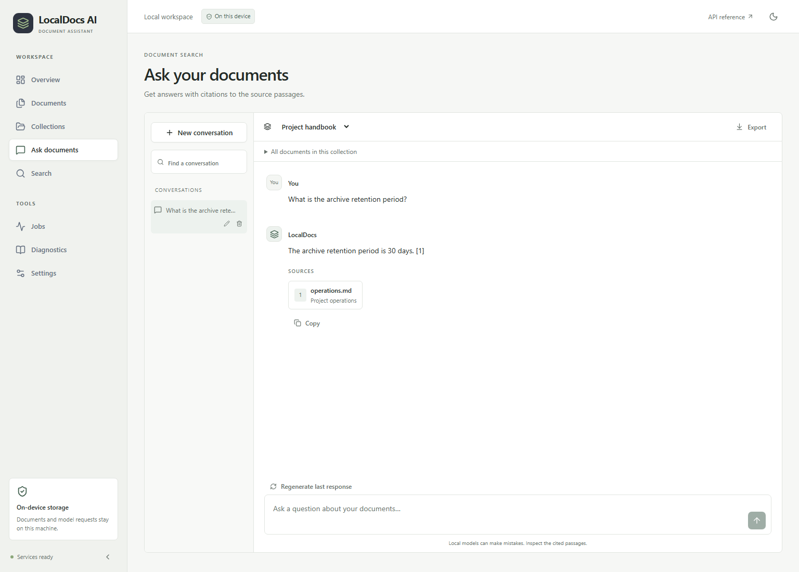

# LocalDocs AI

**Search and talk to your documents on your own machine.** Upload a PDF, Word document, text file, or Markdown note. LocalDocs extracts and indexes its passages, then answers questions with references to the source pages. Documents, vectors, conversations, and model inference stay in your local environment.

[](https://github.com/MDCran/localdocs-ai/actions/workflows/ci.yml)
[](LICENSE)
[](pyproject.toml)
[](apps/web/package.json)



*The dashboard brings the sample collection, document status, and recent activity into one view.*

## Start locally

Install [Docker Desktop](https://docs.docker.com/desktop/), [Ollama](https://ollama.com/download), Python 3.12+, [uv](https://docs.astral.sh/uv/), and Node.js 24+. Download the local models once:

```sh
ollama pull nomic-embed-text
ollama pull llama3.2:3b
```

Then start PostgreSQL, Redis, the API, the worker, and the web interface:

```sh
uv sync --frozen
uv run python scripts/setup.py
docker compose up --build
```

Open [localhost:5178](http://localhost:5178). The first run downloads the container images and application dependencies. Inference runs through Ollama on the host; the Compose stack does not download model weights.

To load the synthetic example documents, run `uv run python scripts/seed.py` in a second terminal. It creates a collection and queues three real Markdown documents for extraction and embedding.

For step by step Windows with WSL2, macOS, Linux, developer setup, GPU notes, and troubleshooting, see the [setup guide](docs/setup.md). The default ports bind to loopback. Do not expose the single user application to a shared network.

## What you can do

- Organize documents into collections and choose the document scope of a question.
- Extract text from PDF, DOCX, TXT, and Markdown files, with page references where available.
- Embed passages locally and search with cosine similarity, PostgreSQL full text, or reciprocal rank fusion.
- Stream locally generated answers with checked citations and source excerpt cards.
- Create, rename, resume, export, and delete persistent conversations.
- Track durable ingestion jobs, bounded retries, failures, document reprocessing, and deletion.
- Inspect retrieval method, candidate count, model metadata, and timings.
- Configure the generation model, temperature, result count, context budget, similarity threshold, and hybrid retrieval.
- Review light and dark dashboards, searchable document lists, and source previews on mobile or desktop.

## How it works



PostgreSQL owns both the vector index and durable job state; Redis only signals waiting workers. Each job uses a time limited lease and a fencing token. Embeddings include model and dimensionality metadata. Answers receive only the current question, the recent conversation history, and bounded retrieved passages. History helps interpret follow ups, but it does not become search evidence. Passages explicitly marked as untrusted or adversarial are omitted from ordinary factual answers and remain available for source inspection. The model has no tools to execute document content.

Each citation points to a source passage supplied during generation. A citation that references another ID is labeled as unverified. Citation excerpts are saved with conversations so a reference survives deletion of its source file. The full [architecture and database decisions](docs/architecture.md) explain the design and its tradeoffs.

## Interface



*The chat workspace pairs a response with the actual source excerpts and page numbers.*

The product interface uses a restrained Nord inspired palette, clear document states, citation previews, accessible keyboard navigation, and an optional dark theme. See the [design notes](docs/design.md) for the choices behind the layout.

## Stack

| Layer | Components |
| --- | --- |
| Web | React, TypeScript, Vite, Tailwind CSS, Radix UI, TanStack Query, React Router |
| API | Python 3.12+, FastAPI, Pydantic, SQLAlchemy async, Alembic |
| Retrieval | Local Ollama embeddings, pgvector, PostgreSQL full text, reciprocal rank fusion |
| Generation | Local Ollama through LangChain, streamed over server sent events |
| Jobs and files | PostgreSQL job leases, Redis wakeups, local filesystem, bounded parser process |
| Delivery | Docker Compose, Ruff, mypy, ESLint, pytest, Vitest, Playwright, GitHub Actions |

## Evaluation

Run the reproducible retrieval evaluation against downloaded models:

```sh
uv run python scripts/evaluate.py
uv run python scripts/evaluate.py --answers
```

The first command reports Recall@K and mean reciprocal rank for keyword, vector, and hybrid search. The optional answer pass records citation validity, expected fact checks, cited passage coverage, abstention, and an injection regression check. Reports capture the run time, settings, model names, passages, and measured outcomes. This repository does not publish synthetic benchmark claims. Expected fact and refusal checks use phrase matching, so review answers against their cited evidence.

The optional live verification performs a real PDF upload, local embedding, vector search, Ollama response, citation persistence, and document deletion:

```sh
uv run python scripts/smoke_live.py
```

Deterministic unit and integration tests use model fixtures; CI does not download model weights. The browser CI starts a small local Ollama protocol fixture. See the [evaluation methodology](docs/evaluation.md) for what these results can and cannot demonstrate.

## Tests and quality checks

```sh
uv run ruff check .
uv run mypy
uv run python scripts/test.py
cd apps/web
npm ci
npm run lint
npm test
npm run build
```

`scripts/test.py` uses a database name ending in `_test`, runs migrations, and refuses to truncate a database without that suffix. The browser suite exercises uploads, real local retrieval, answers, citation sources, persistence, deletion, mobile navigation, keyboard access, and theme switching.

## REST API

The interactive OpenAPI reference is served at `/api/docs`; the schema is at `/api/openapi.json`. Key endpoints include collections and document management, jobs and progress, conversation streaming, retrieval and diagnostics, model status, health, and runtime settings. The [API guide](docs/api.md) lists the route families.

## Security and scope

The stack serves one local user. It does not implement sign in or multi tenancy. PostgreSQL, Redis, the API, and the interface bind to localhost. Do not expose these ports to a shared network without adding and reviewing an authentication and deployment boundary. File uploads are size limited, content checked, and stored under generated IDs. Archive extraction limits guard malformed DOCX files; PDF and DOCX parsers run in a bounded child process. Logs omit document content. Document instructions cannot invoke a tool. See the [security policy](SECURITY.md) and [limitations](docs/limitations.md).

OCR, visual layout extraction, cloud inference, collaboration, and remote hosting are not included. Scanned PDFs report that OCR is needed. CPU inference can take time, and PDF page extraction order depends on the source file. Untrusted passage handling uses explicit labels and markers; it does not identify every possible prompt injection.

## Project notes

- [Architecture, data flow, and tradeoffs](docs/architecture.md)
- [Database schema](docs/database.md)
- [Local setup](docs/setup.md)
- [API reference](docs/api.md)
- [Evaluation methodology](docs/evaluation.md)
- [Troubleshooting](docs/troubleshooting.md)
- [Product design](docs/design.md)
- [Roadmap](docs/roadmap.md)
- [Security policy](SECURITY.md)
- [Contributing](CONTRIBUTING.md)

## License

MIT. See [LICENSE](LICENSE).
