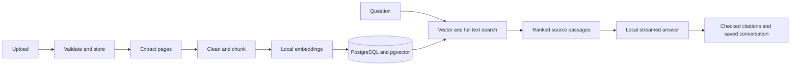

# LocalDocs AI

[](https://github.com/MDCran/localdocs-ai/actions/workflows/security-checks.yml) [](https://github.com/MDCran/localdocs-ai/security/code-scanning)

LocalDocs AI is a local document assistant. It indexes PDF, Word, text, and Markdown files, then answers questions with citations to the source passages. Documents, conversations, embeddings, and model inference stay in your local setup.

## App screenshots

These captures show the document dashboard and cited chat experience.

### Dashboard


### Chat


## Highlights

- Upload PDF, DOCX, TXT, and Markdown files; follow extraction and indexing jobs through completion.
- Organize files into collections and choose the document scope for each question.
- Search with local embeddings, PostgreSQL full text, or hybrid ranking.
- Stream answers with citations, source excerpts, and page references where available.
- Resume, export, and delete saved conversations.
- Review retrieval diagnostics, model details, and request timings.

## Stack

| Area | Components |
| --- | --- |
| Web | React, TypeScript, Vite, Tailwind CSS, Radix UI, TanStack Query |
| API | Python 3.12+, FastAPI, Pydantic, SQLAlchemy, Alembic |
| Retrieval | Ollama embeddings, PostgreSQL, pgvector, PostgreSQL full text search |
| Generation | Ollama with LangChain, streamed to the web app over server-sent events |
| Jobs and files | PostgreSQL job leases, Redis wakeups, local filesystem |
| Quality | Ruff, mypy, pytest, ESLint, Vitest, Playwright, GitHub Actions |

## Architecture



PostgreSQL stores document metadata, vectors, conversations, and job data; uploaded files stay on the local filesystem. Redis signals waiting workers. Answers use the current question, recent conversation history, and a bounded set of retrieved passages. Explicitly marked untrusted passages remain available for source inspection and are excluded from ordinary factual answers. The model has no tools for executing document content. See the [architecture notes](docs/architecture.md) for the design details.

## Requirements

To run the app, install [Docker Desktop](https://docs.docker.com/desktop/), [Ollama](https://ollama.com/download), Python 3.12+, and [uv](https://docs.astral.sh/uv/). Frontend development and test commands require Node.js 24+ and npm.

## Getting started

Download the local models once:

```bash
ollama pull nomic-embed-text
ollama pull llama3.2:3b
```

Create the local environment file and start the services:

```bash
uv sync --frozen
uv run python scripts/setup.py
docker compose up --build
```

Open [http://localhost:5178](http://localhost:5178). The first start downloads container images and application dependencies. Ollama runs on the host; Docker Compose does not download model weights.

To load the example documents, open a second terminal and run:

```bash
uv run python scripts/seed.py
```

The default ports bind to loopback. For platform-specific setup, GPU notes, and troubleshooting, see the [local setup guide](docs/setup.md).

## Configuration

The setup script creates `.env` from [.env.example](.env.example) and generates a local database password. Change `CHAT_MODEL` or `EMBEDDING_MODEL` there to use different Ollama models. Changing the embedding model may require reprocessing existing documents. The [setup guide](docs/setup.md) covers model compatibility, GPU configuration, and Docker networking.

## API routes

All API routes use the `/api/v1` prefix. The interactive reference is available at [`/api/docs`](http://localhost:8008/api/docs); the machine-readable schema is at `/api/openapi.json`.

| Route | Purpose |
| --- | --- |
| `/api/v1/collections` | Create and manage document collections |
| `/api/v1/documents` | Upload, inspect, reprocess, and delete documents |
| `/api/v1/jobs` | Check ingestion status and receive progress events |
| `/api/v1/retrieval/search` | Search indexed passages |
| `/api/v1/conversations` | Stream answers, inspect citations, and manage saved conversations |
| `/api/v1/settings`, `/api/v1/models` | Read runtime settings and available models |
| `/api/v1/health`, `/api/v1/ready`, `/api/v1/metrics` | Check service health and metrics |

See the [API guide](docs/api.md) for the full route list.

## Tests and evaluation

Run backend checks from the repository root:

```bash
uv run ruff check .
uv run mypy
uv run python scripts/test.py
```

Run frontend checks from `apps/web`:

```bash
npm ci
npm run lint
npm test
npm run build
```

The browser suite covers uploads, retrieval, cited answers, conversation persistence, mobile navigation, keyboard access, and theme switching. To run the retrieval evaluation and optional answer checks, use `uv run python scripts/evaluate.py` and `uv run python scripts/evaluate.py --answers`. See the [evaluation methodology](docs/evaluation.md) for the scope and limits of those checks.

## Security and privacy

LocalDocs AI is designed for one local user; it does not include sign-in or multi-user isolation. Keep the services on loopback unless you add an authentication and deployment boundary. Uploads are size-limited and stored under generated IDs. Document parsers run in a bounded process, and logs omit document content. See the [security policy](SECURITY.md) and [known limitations](docs/limitations.md).

## Documentation

- [Architecture and design decisions](docs/architecture.md)
- [Database schema](docs/database.md)
- [Local setup](docs/setup.md)
- [Troubleshooting](docs/troubleshooting.md)
- [API reference](docs/api.md)
- [Evaluation methodology](docs/evaluation.md)
- [Product design notes](docs/design.md)
- [Roadmap](docs/roadmap.md)
- [Contributing](CONTRIBUTING.md)

## Ownership

Built and maintained by [MDCran](https://github.com/MDCran).

## License

MIT. See [LICENSE](LICENSE).
