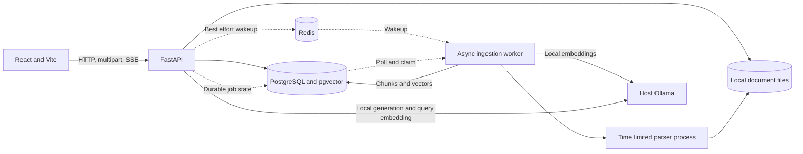
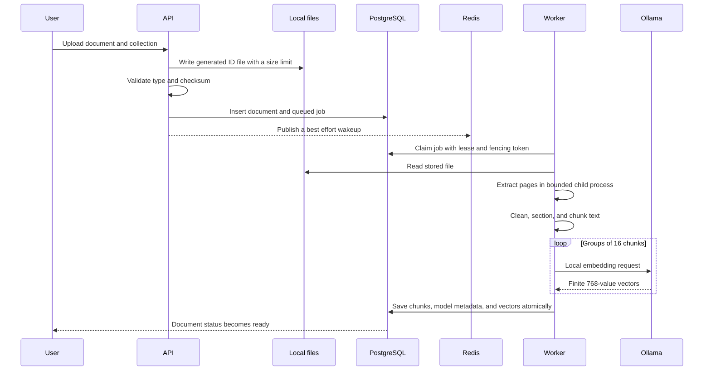
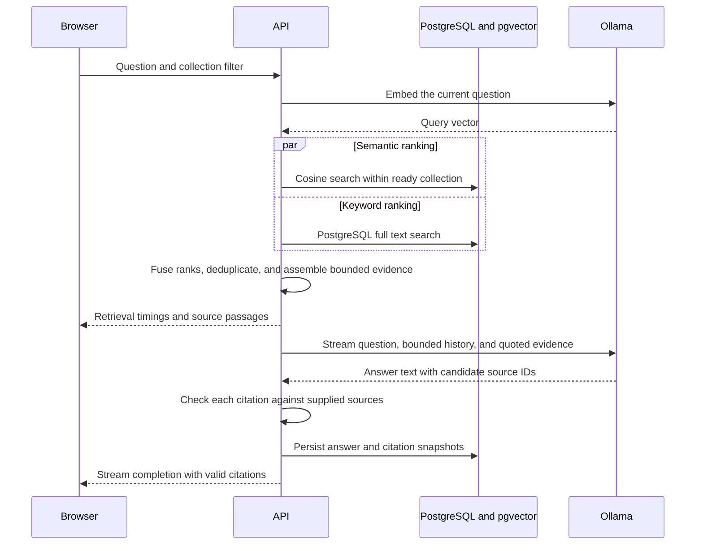
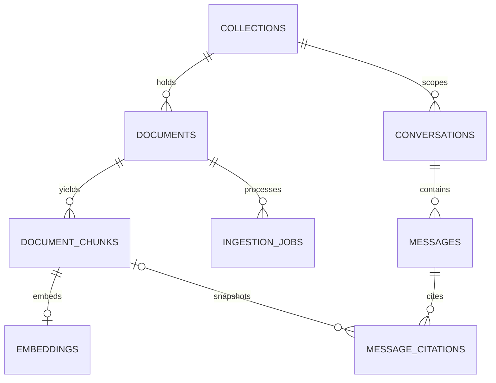

# Architecture

The web client talks to a versioned FastAPI API. Uploaded files are validated and stored under generated identifiers before a durable PostgreSQL job is created. Redis is a wakeup signal; PostgreSQL holds the queue. Workers can recover queued jobs when a wakeup is missed or a process restarts. A lease token prevents a worker that lost its claim from saving stale vectors. Extraction runs in a bounded child process; embedding and indexing run in retryable stages.

## System boundaries

## Upload and ingestion

## Retrieval and generation

## Database relationships

The embedding column is fixed at 768 dimensions. Model name and dimension are stored with each vector and checked before retrieval. HNSW cosine indexing accelerates semantic search; a GIN full text index supports keyword search. Hybrid ranking uses reciprocal rank fusion. Neither semantic scores nor fused ranking scores are probabilities of answer correctness.

## Decisions and tradeoffs

- PostgreSQL stores application metadata, the durable job queue, full text search, and vectors. A single indexed store simplifies local setup and collection filtering.
- Redis avoids busy polling without becoming a second source of truth.
- The current question is embedded without rewriting it from conversation history. Recent turns help the model interpret follow ups; they do not become retrieval evidence.
- History is limited to eight recent turns and passages to a conservative UTF 8 byte estimate. Model tokenization varies, so this estimate is a ceiling aid rather than an exact token count.
- Local reranking is deferred until a reproducible corpus shows a useful quality benefit.
- HNSW approximate search trades a small amount of recall for lower latency at scale. Iterative scans recover additional qualifying rows after collection filters.
- There is no OCR. Image only PDFs fail with a clear OCR required status.
- DOCX text includes paragraphs and tables, but visual layout, images, page numbers, and reading order across complex columns are not preserved.
- Conversation ownership is local single user. Authentication and multitenancy are outside the current threat model.
